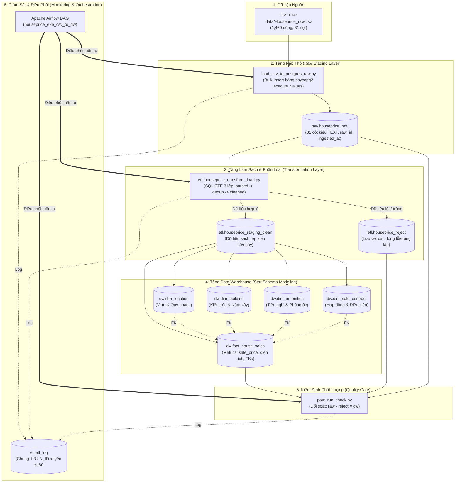

# 📑 TỔNG QUAN DỰ ÁN END-TO-END DATA ENGINEERING PIPELINE
## Dự án: Houseprice Data Warehouse & Automated Pipeline with Apache Airflow

> **Mục tiêu**: Xây dựng một quy trình xử lý dữ liệu hoàn chỉnh từ nguồn file thô (CSV), lưu trữ vùng đệm (Staging), làm sạch & chuẩn hóa dữ liệu, mô hình hóa theo kiến trúc Data Warehouse (Star Schema), kiểm định chất lượng dữ liệu (Data Quality Gate) và tự động hóa điều phối toàn bộ bằng Apache Airflow trên nền tảng Docker.

---

## 📊 PHẦN 1: TỔNG QUAN VỀ DỮ LIỆU (DATASET OVERVIEW)

### 1.1 Thông tin chung
- **Tập dữ liệu**: **Ames Housing Dataset** (thành phố Ames, bang Iowa, Hoa Kỳ). Đây là tập dữ liệu kinh điển trong phân tích dữ liệu và định giá bất động sản.
- **File nguồn**: `data/Houseprice_raw.csv` (định dạng CSV, mã hóa UTF-8).
- **Quy mô**: **1,460 dòng** (tương ứng 1,460 căn nhà giao dịch) và **81 cột thuộc tính**.

### 1.2 Biến mục tiêu — `SalePrice` (Giá bán nhà)
- **Đơn vị**: Đô la Mỹ ($ USD).
- **Giá trị nhỏ nhất (Min)**: \$34,900.
- **Giá trị lớn nhất (Max)**: \$755,000.
- **Giá trị trung bình (Mean)**: \$180,921.
- **Giá trị trung vị (Median)**: \$163,000.
- **Phân phối**: Lệch phải (Right-skewed) do một số căn biệt thự cao cấp kéo giá trị trung bình lên cao hơn trung vị.

### 1.3 Phân loại 8 nhóm thuộc tính chính (81 cột)

| Nhóm thuộc tính | Số cột | Các cột tiêu biểu | Ý nghĩa nghiệp vụ |
|---|:---:|---|---|
| **1. Định danh & Vị trí đất** | 13 | `Id`, `MSSubClass`, `MSZoning`, `LotFrontage`, `LotArea`, `LotConfig`, `Neighborhood` | Xác định vị trí địa lý, quy hoạch đô thị, kích thước và hình dáng thửa đất. |
| **2. Môi trường & Kết cấu** | 12 | `Condition1/2`, `BldgType`, `HouseStyle`, `YearBuilt`, `YearRemodAdd`, `OverallQual`, `OverallCond` | Loại hình nhà (nhà riêng, liền kề), phong cách thiết kế, năm xây dựng/cải tạo và điểm đánh giá chất lượng hoàn thiện (thang điểm 1-10). |
| **3. Vật liệu & Móng nhà** | 5 | `MasVnrType`, `MasVnrArea`, `ExterQual`, `ExterCond`, `Foundation` | Loại móng (bê tông, gạch), vật liệu ốp tường ngoài và tình trạng bảo trì ngoại thất. |
| **4. Tầng hầm (Basement)** | 11 | `BsmtQual`, `TotalBsmtSF`, `BsmtFinType1/2`, `BsmtFinSF1/2`, `BsmtFullBath` | Chiều cao tầng hầm, diện tích hoàn thiện, số phòng tắm tầng hầm. |
| **5. Không gian sống & Nội thất** | 14 | `GrLivArea`, `1stFlrSF`, `2ndFlrSF`, `FullBath`, `HalfBath`, `BedroomAbvGr`, `KitchenQual` | Tổng diện tích sàn sinh hoạt trên mặt đất, số phòng ngủ, phòng tắm và chất lượng gian bếp. |
| **6. Nhà để xe (Garage)** | 11 | `GarageType`, `GarageCars`, `GarageArea`, `GarageQual`, `GarageCond`, `GarageFinish` | Vị trí gara (liền nhà/tách rời), sức chứa số lượng xe ô tô và diện tích nhà để xe. |
| **7. Sân vườn & Tiện ích phụ** | 9 | `WoodDeckSF`, `OpenPorchSF`, `EnclosedPorch`, `PoolArea`, `PoolQC`, `Fence` | Diện tích hiên nhà, sàn gỗ ngoài trời, chất lượng hàng rào và hồ bơi. |
| **8. Thông tin giao dịch & Giá** | 6 | `MoSold`, `YrSold`, `SaleType`, `SaleCondition`, `SalePrice` | Thời điểm chốt bán (tháng/năm), loại hợp đồng giao dịch và giá bán thực tế. |

> ⚠️ **Đặc thù dữ liệu quan trọng**: Giá trị `NA` ở các cột tiện ích (`GarageType`, `PoolQC`, `Alley`, `Fence`, `FireplaceQu`) trong bộ dữ liệu này **không phải là dữ liệu thiếu (missing data)**, mà biểu thị trạng thái **"Không có tiện ích đó"** (không có gara, không có hồ bơi, không có lò sưởi). Đây là điểm mấu chốt để xử lý trong tầng Transform.

---

## 🔄 PHẦN 2: SƠ ĐỒ LUỒNG PIPELINE END-TO-END

### 2.1 Sơ đồ Kiến trúc Tổng thể (Architecture Flow)



### 2.2 Chuỗi thực thi các Task trong Airflow DAG
```text
[start (EmptyOperator)]
        │
        ▼
[ingest_csv_to_raw (BashOperator)]       --> Chạy load_csv_to_postgres_raw.py
        │
        ▼
[transform_load_dw (BashOperator)]       --> Chạy etl_houseprice_transform_load.py
        │
        ▼
[post_run_check (BashOperator)]          --> Chạy post_run_check.py
        │
        ▼
[end (EmptyOperator)]
```

---

## 🏛️ PHẦN 3: CHI TIẾT TỪNG LAYER TRONG HỆ THỐNG

### 🔹 Layer 1: Raw / Staging Layer (Tầng Lưu trữ Thô)
- **Vị trí**: Schema `raw`, bảng `raw.houseprice_raw`.
- **Cơ chế hoạt động**:
  - Script [load_csv_to_postgres_raw.py](file:///d:/project_mindx_02/dags/scripts/load_csv_to_postgres_raw.py) thực thi lệnh `TRUNCATE TABLE raw.houseprice_raw;` trước khi nạp để đảm bảo tính bất biến (Idempotent).
  - Đọc file CSV và nạp toàn bộ 81 cột vào bảng bằng `execute_values` của thư viện `psycopg2` (tốc độ cao, chỉ mất < 0.5 giây).
- **Đặc điểm kỹ thuật**:
  - Toàn bộ 81 cột thuộc tính đều được khai báo kiểu **`TEXT`**.
  - Bổ sung 2 cột hệ thống: `raw_id BIGSERIAL PRIMARY KEY` (khóa tự tăng) và `ingested_at TIMESTAMP` (thời điểm nạp).
- **Tác dụng**:
  - **Single Source of Truth**: Giữ trọn vẹn 100% dữ liệu gốc, không làm biến đổi bất kỳ giá trị nào.
  - **Chống lỗi định dạng (Fail-safe)**: Nếu dữ liệu có chứa ký tự lạ, ngày sai format hay chuỗi `"NA"` ở cột số thì quá trình nạp vẫn thành công mà không bị sập pipeline.
  - **Tách biệt Ingestion và Transformation**: Nếu cần thay đổi thuật toán làm sạch, chỉ cần chạy lại từ bảng `raw` mà không cần đọc lại file đĩa cứng.

---

### 🔹 Layer 2: Clean Staging & Quarantine Layer (Tầng Làm sạch & Cách ly Dữ liệu Lỗi)
- **Vị trí**: Schema `etl`, gồm 2 bảng:
  1. `etl.houseprice_staging_clean`: Chứa các bản ghi đã được làm sạch và ép kiểu chuẩn.
  2. `etl.houseprice_reject`: Chứa các bản ghi bị loại bỏ cùng lý do vi phạm.
- **Cơ chế xử lý (3 tầng CTE)**:
  1. **Tầng `parsed`**:
     - *Xử lý Missing Data*: Đổi `NA` ở các cột tiện ích (`garage_type`, `pool_qc`) thành giá trị hợp lệ `'None'`. Các cột chữ rỗng được gán giá trị mặc định (`'Unknown'`, `'Norm'`, `'1Fam'`).
     - *Ép kiểu an toàn bằng Regex*: Kiểm tra định dạng số dương bằng biểu thức chính quy (`saleprice ~ '^[0-9]+(\.[0-9]+)?$'`) trước khi cast sang `NUMERIC(12,2)`. Các cột diện tích ép sang `NUMERIC(10,2)`, năm và số phòng ép sang `INT`. Bất kỳ chuỗi lỗi nào sẽ chuyển thành `NULL` thay vì làm gián đoạn chương trình.
  2. **Tầng `dedup`**:
     - Áp dụng kỹ thuật `DISTINCT ON (house_id) ... ORDER BY house_id, raw_id DESC` để tự động khử trùng lặp và giữ lại bản ghi mới nhất.
  3. **Tầng `cleaned`**:
     - Lọc các bản ghi đạt chuẩn: `house_id IS NOT NULL AND sale_price IS NOT NULL AND sale_price > 0`.
- **Cơ chế Bảng Reject (`etl.houseprice_reject`)**:
  - Tự động phát hiện các dòng không vào được `staging_clean` và chèn vào bảng reject kèm lý do chi tiết:
    - `'Invalid ID format'`: Thiếu ID hoặc ID không phải số.
    - `'Invalid or non-positive sale_price'`: Giá bán rỗng, sai định dạng hoặc $\le 0$.
    - `'Duplicate house_id record'`: Bản ghi trùng lặp mã nhà.
- **Tác dụng**:
  - Đảm bảo tính minh bạch (Data Auditability): **Không một dòng dữ liệu nào bị âm thầm biến mất**. Mọi dòng bị loại đều có nguyên nhân rõ ràng để đối soát.

---

### 🔹 Layer 3: Data Warehouse Layer (Mô hình Star Schema Phân tích)
- **Vị trí**: Schema `dw`, được tổ chức theo chuẩn **Star Schema** gồm 4 bảng Dimension và 1 bảng Fact trung tâm.

```
       [dw.dim_location]         [dw.dim_building]
               │                         │
               └──────────┐   ┌──────────┘
                          ▼   ▼
                  [dw.fact_house_sales]
                          ▲   ▲
               ┌──────────┘   └──────────┐
               │                         │
      [dw.dim_amenities]        [dw.dim_sale_contract]
```

1. **`dw.dim_location` (Vị trí & Quy hoạch)**:
   - Thuộc tính: `neighborhood`, `ms_zoning`, `condition1/2`, `lot_config`, `land_contour`.
   - Khóa chính: `location_id SERIAL PRIMARY KEY`.
2. **`dw.dim_building` (Kiến trúc & Công trình)**:
   - Thuộc tính: `bldg_type`, `house_style`, `year_built`, `year_remod_add`, `overall_qual`, `overall_cond`, `foundation`, `roof_style`.
   - Khóa chính: `building_id SERIAL PRIMARY KEY`.
3. **`dw.dim_amenities` (Nội thất & Tiện nghi sống)**:
   - Thuộc tính: `central_air`, `heating_qc`, `kitchen_qual`, `full_bath`, `half_bath`, `bedroom_abv_gr`, `fireplaces`, `garage_type`, `garage_cars`, `pool_area`, `pool_qc`.
   - Khóa chính: `amenities_id SERIAL PRIMARY KEY`.
4. **`dw.dim_sale_contract` (Điều kiện Mua bán)**:
   - Thuộc tính: `sale_type`, `sale_condition`.
   - Khóa chính: `contract_id SERIAL PRIMARY KEY`.
5. **`dw.fact_house_sales` (Bảng Fact trung tâm)**:
   - Khóa chính: `sale_id SERIAL PRIMARY KEY`.
   - Khóa ngoại (FK): Liên kết tới 4 Dimension (`location_id`, `building_id`, `amenities_id`, `contract_id`).
   - Các Metric định lượng: `sale_price` (Target), `lot_area`, `gr_liv_area`, `total_bsmt_sf`, `garage_area`, `wood_deck_sf`, `open_porch_sf`, `mo_sold`, `yr_sold`.
   - Đã đánh Index tối ưu truy vấn: `idx_fact_location`, `idx_fact_building`, `idx_fact_yr_sold`.
- **Kỹ thuật liên kết Dimension $\rightarrow$ Fact**:
  - Sử dụng toán tử **`LEFT JOIN ... IS NOT DISTINCT FROM`** trên từng thuộc tính phân loại. Kỹ thuật này xử lý an toàn giá trị `NULL` trong SQL, đảm bảo liên kết chính xác 100% khóa ngoại mà **không làm mất dòng dữ liệu nào**.
- **Tác dụng**:
  - Triệt tiêu dư thừa dữ liệu (Data Redundancy), tiết kiệm dung lượng lưu trữ.
  - Tối ưu hóa hiệu năng truy vấn cho các báo cáo phân tích, Dashboard BI (PowerBI, Tableau, Superset) và làm Feature Store cho các bài toán Machine Learning dự đoán giá nhà.

---

### 🔹 Layer 4: Quality Gate & Validation Layer (Tầng Kiểm định Chất lượng)
- **Vị trí**: Script [dags/scripts/post_run_check.py](file:///d:/project_mindx_02/dags/scripts/post_run_check.py).
- **Bộ quy tắc kiểm định tự động**:
  1. **Kiểm tra rỗng**: Báo lỗi nếu bảng Fact không có dữ liệu (`dw_cnt == 0`).
  2. **Kiểm tra Anomaly (Bất thường)**: Quét toàn bộ bảng Fact, phát hiện nếu có căn nhà nào có giá `sale_price <= 0` hoặc `NULL`.
  3. **Kiểm tra Khóa ngoại mồ côi (Orphan FK Check)**: Đảm bảo không có bản ghi Fact nào bị thiếu liên kết tới bất kỳ Dimension nào (`location_id IS NULL`, `building_id IS NULL`...).
  4. **Đối soát Toán học Nghiêm ngặt (Strict Equation Audit)**:
     $$\text{raw\_cnt} - \text{rejected\_cnt} == \text{dw\_cnt}$$
     *(Số dòng nạp vào ban đầu trừ đi số dòng bị loại bắt buộc phải bằng chính xác số dòng trong Data Warehouse).*
- **Tác dụng**: Đóng vai trò "người gác cổng" (Quality Gate). Nếu phát hiện bất kỳ sai lệch nào, script sẽ trả về `sys.exit(1)`, khiến Task Airflow báo đỏ để kỹ sư vận hành xử lý ngay lập tức, ngăn ngừa dữ liệu bẩn lọt vào tầng kinh doanh.

---

### 🔹 Layer 5: Observability & Logging Layer (Tầng Giám sát & Truy vết)
- **Vị trí**: Schema `etl`, bảng `etl.etl_log`.
- **Cấu trúc bảng**: `log_id`, `run_id`, `step_name`, `status`, `message`, `created_at`.
- **Cơ chế kỹ thuật**:
  - **Đồng bộ mã phiên chạy (Traceability)**: Airflow truyền biến `"RUN_ID": "{{ run_id }}"` qua môi trường. Cả 3 script con đều đọc biến này, giúp **toàn bộ các bước trong 1 lần chạy đều có chung 1 `run_id` duy nhất**.
  - **Ghi log an toàn (Safe Rollback Logging)**: Trong khối `except Exception`: script thực hiện `conn.rollback()` để hủy transaction lỗi trước, sau đó bật `conn.autocommit = True` để ghi log `FAIL`. Điều này đảm bảo bản ghi lỗi luôn được lưu vào DB ngay cả khi tiến trình chính bị sập.
- **Tác dụng**: Cung cấp khả năng quan sát (Observability), giúp kỹ sư dễ dàng kiểm tra lịch sử chạy, số lượng dòng xử lý qua từng bước và thời gian thực thi bằng câu lệnh:
  ```sql
  SELECT * FROM etl.etl_log WHERE run_id = 'manual__...' ORDER BY created_at ASC;
  ```

---

### 🔹 Layer 6: Orchestration & Infrastructure Layer (Tầng Điều phối & Hạ tầng)
- **Công nghệ**: **Apache Airflow 2.8.1** + **PostgreSQL 15** trên nền **Docker Compose**.
- **Tính năng nổi bật**:
  - **Bảo mật**: Hoàn toàn không hard-code tài khoản/mật khẩu trong mã nguồn; sử dụng file cấu hình môi trường `.env` (được bảo vệ bởi `.gitignore`) và file mẫu `.env.example`.
  - **Phụ thuộc có điều kiện (Healthcheck)**: Container `postgres` cấu hình kiểm tra sức khỏe `pg_isready -U airflow`; Airflow cấu hình `depends_on: postgres: condition: service_healthy` để đảm bảo cơ sở dữ liệu đã sẵn sàng nhận kết nối trước khi Scheduler/Webserver khởi động.
  - **Tự động phục hồi (Fault Tolerance)**: Cấu hình `retries=2` và `retry_delay=1m` để tự động chạy lại nếu phát sinh sự cố tạm thời.
  - **Tính bất biến (Idempotent)**: Quy trình sử dụng chiến lược `TRUNCATE` trước khi nạp ở cả tầng Raw và Data Warehouse, đảm bảo dù chạy lại nhiều lần thì dữ liệu vẫn luôn nhất quán, không bao giờ bị trùng lặp.

---

## 📌 BẢNG TỔNG KẾT VAI TRÒ CÁC THÀNH PHẦN

| Thành phần | Công nghệ / File | Vai trò & Tác dụng chính |
|---|---|---|
| **Raw Staging** | `raw.houseprice_raw` | Lưu trữ nguyên vẹn dữ liệu gốc 81 cột kiểu `TEXT`, chống fail khi nạp. |
| **Clean Staging** | `etl.houseprice_staging_clean` | Chứa dữ liệu sạch đã ép kiểu số dương, xử lý NA và khử trùng lặp. |
| **Quarantine Table** | `etl.houseprice_reject` | Lưu vết các dòng dữ liệu bị loại kèm lý do phục vụ đối soát. |
| **Dimension Tables** | `dw.dim_*` (4 bảng) | Chuẩn hóa các chiều phân tích (vị trí, kiến trúc, tiện nghi, hợp đồng). |
| **Fact Table** | `dw.fact_house_sales` | Lưu trữ chỉ số đo lường trung tâm (giá bán, diện tích) và liên kết khóa ngoại. |
| **Data Quality Gate** | `post_run_check.py` | Kiểm tra orphan FK, giá âm và đối soát toán học $raw - reject = dw$. |
| **Pipeline Audit Log** | `etl.etl_log` | Giám sát lịch sử thực thi xuyên suốt các bước chung 1 `run_id`. |
| **Workflow Orchestration** | `houseprice_e2e_csv_to_dw_dag.py` | Điều phối tự động hóa chuỗi chạy tuần tự, hỗ trợ retry khi lỗi. |
| **Container Infrastructure**| `docker-compose.yaml` | Cô lập môi trường chạy, quản lý volume và healthcheck phụ thuộc. |
| **Configuration** | `.env` / `.env.example` | Quản lý biến môi trường bảo mật, tách biệt tài khoản khỏi mã nguồn. |
