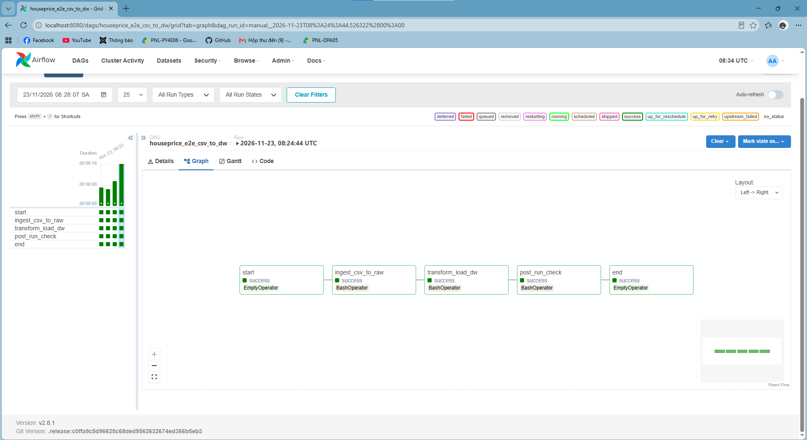
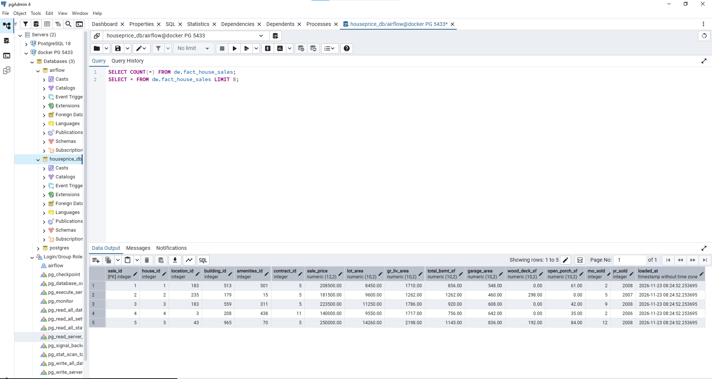
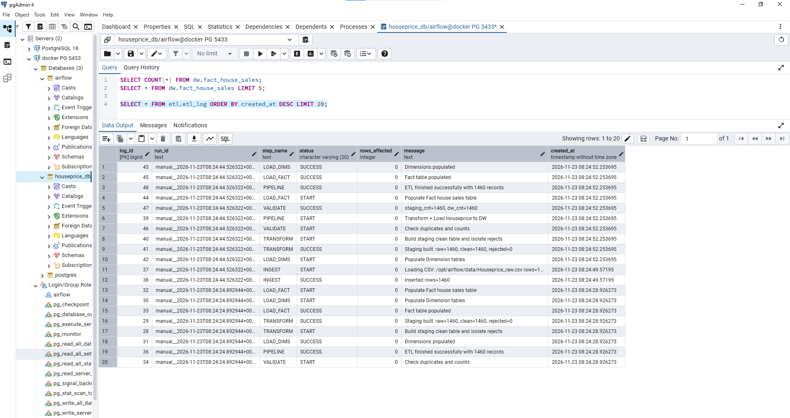

# Houseprice Airflow E2E Project (CSV -> Postgres -> DW)

Pipeline End-to-End thu thập, lưu trữ Staging (Raw), làm sạch và xây dựng Data Warehouse (Star Schema) cho tập dữ liệu **Houseprice (Ames Housing)** điều phối tự động bởi **Apache Airflow**.

---

## 🚀 Quick Start (Hướng dẫn chạy nhanh)

### Bước 1: Chuẩn bị Môi trường (Cài đặt lần đầu)
1. Tạo file cấu hình môi trường `.env` từ file mẫu `.env.example`:
   ```bash
   cp .env.example .env
   ```
2. Mở file `.env` và thiết lập tài khoản PostgreSQL (mặc định cho local demo):
   ```env
   DB_HOST=postgres
   DB_PORT=5432
   DB_NAME=houseprice_db
   DB_USER=airflow
   DB_PASS=airflow
   CSV_PATH=/opt/airflow/data/Houseprice_raw.csv
   ```

### Bước 2: Khởi động Containers với Docker
1. **Khởi động Docker Desktop** (đảm bảo Docker ở trạng thái *Running*).
2. **Khởi tạo Database & Tài khoản Admin Airflow (chỉ chạy 1 lần đầu)**:
   ```bash
   docker compose up airflow-init
   ```
3. **Khởi chạy toàn bộ hệ thống (PostgreSQL, Airflow Webserver, Scheduler)**:
   ```bash
   docker compose up -d
   ```

### Bước 3: Kích hoạt Pipeline trên Airflow UI
1. Mở trình duyệt truy cập: [http://localhost:8080](http://localhost:8080)
2. Đăng nhập với tài khoản: `admin` / Mật khẩu: `admin`
3. Tìm DAG có tên: **`houseprice_e2e_csv_to_dw`**
4. Bật công tắc (Unpause) và nhấn nút **Trigger DAG** (nút Play).

---

## 🔍 Kiểm tra Dữ liệu & Đối Soát (Data Quality & Verification)

Kết nối vào PostgreSQL (Container) từ DBeaver / pgAdmin:
- **Host**: `localhost`
- **Port**: `5433` *(đã map port 5433 để tránh trùng với Postgres local 5432)*
- **Database**: `houseprice_db`
- **User**: `airflow`
- **Password**: `airflow`

### Chạy Script Kiểm tra Độc lập:
Bạn có thể mở và thực thi trực tiếp toàn bộ script:
👉 **[sql/02_verify_data_warehouse.sql](file:///d:/project_mindx_02/sql/02_verify_data_warehouse.sql)**

Hoặc chạy các câu lệnh kiểm tra cốt lõi:
```sql
-- 1. Đối soát số lượng: raw - reject = dw
WITH counts AS (
    SELECT
        (SELECT COUNT(*) FROM raw.houseprice_raw) AS raw_cnt,
        (SELECT COUNT(*) FROM etl.houseprice_reject) AS reject_cnt,
        (SELECT COUNT(*) FROM dw.fact_house_sales) AS dw_cnt
)
SELECT raw_cnt, reject_cnt, dw_cnt, (raw_cnt - reject_cnt) AS expected_dw_cnt FROM counts;

-- 2. Kiểm tra số lượng bản ghi trên các bảng Dimension
SELECT 'dw.dim_location' AS dim_table, COUNT(*) FROM dw.dim_location
UNION ALL
SELECT 'dw.dim_building', COUNT(*) FROM dw.dim_building
UNION ALL
SELECT 'dw.dim_amenities', COUNT(*) FROM dw.dim_amenities
UNION ALL
SELECT 'dw.dim_sale_contract', COUNT(*) FROM dw.dim_sale_contract;

-- 3. Xem nhật ký thực thi Pipeline (chung 1 RUN_ID)
SELECT log_id, run_id, step_name, status, message, created_at 
FROM etl.etl_log 
ORDER BY created_at DESC 
LIMIT 20;
```

---

## 📸 Bằng chứng Thực thi Thành công (Screenshots)

Thư mục chứa ảnh minh chứng: `docs/`
- **Đồ thị DAG Airflow hoàn thành xanh tất cả các task**:
  
- **Dữ liệu Fact & Dimension trong Data Warehouse**:
  
- **Nhật ký bảng `etl.etl_log` hiển thị trọn vẹn 1 `run_id`**:
  

---

## 🛠️ Xử lý Sự cố Thường gặp (Troubleshooting)

### 1. Xung đột cổng kết nối `5433` hoặc `8080`:
- Nếu máy tính của bạn đã có ứng dụng khác chạy trên cổng `5433` hoặc `8080`:
  ```powershell
  # Kiểm tra process đang chiếm cổng trên Windows
  netstat -ano | findstr :5433
  netstat -ano | findstr :8080
  ```
- Bạn có thể đổi cổng ở file [docker-compose.yaml](file:///d:/project_mindx_02/docker-compose.yaml) (ví dụ: `"5434:5432"` hoặc `"8081:8080"`).

### 2. Lỗi quyền truy cập file hoặc biến môi trường:
- Đảm bảo file `.env` đã được tạo từ `.env.example`.
- Nếu task bị lỗi `Missing env var: DB_PASS`, hãy kiểm tra file `.env` đã có đủ các dòng cấu hình tài khoản hay chưa.

### 3. Dọn dẹp & Reset hệ sinh thái từ đầu:
Nếu muốn xóa sạch toàn bộ container và database volume để chạy lại từ trạng thái ban đầu:
```bash
docker compose down -v
docker compose up airflow-init
docker compose up -d
```
