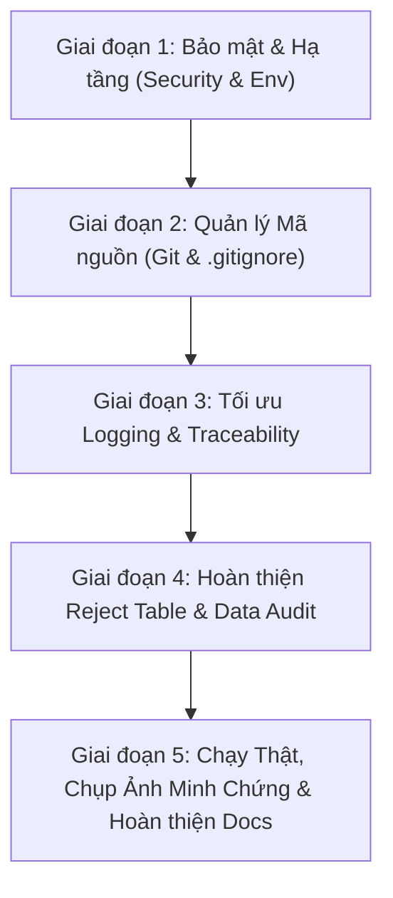

# 📋 Kế Hoạch Nâng Cấp & Chỉnh Sửa Dự Án (Audit & Optimization Plan)
> **Dựa trên báo cáo đánh giá**: [cham_diem_houseprice.md](file:///D:/project_mindx_02/cham_diem_houseprice.md)  
> **Điểm số hiện tại**: **6.5 / 10** $\longrightarrow$ **Mục tiêu sau tối ưu**: **8.5 – 9.0+ / 10**

---

## 📊 Phân Tích Hiện Trạng & Tiềm Năng Nâng Điểm

| Tiêu chí | Điểm hiện tại | Mục tiêu | Điểm cộng | Các điểm nghẽn chính cần khắc phục |
|---|:---:|:---:|:---:|---|
| **TC1. Pipeline tự động hóa** | 1.5 / 2.0 | **2.0** | **+0.5** | Xóa hard-code credentials, dùng `.env` & `.env.example`, thêm `healthcheck` Postgres |
| **TC2. Data Cleaning & Validation** | 1.5 / 2.0 | **2.0** | **+0.5** | Thêm bảng `etl.houseprice_reject`, log chi tiết `rejected_cnt` |
| **TC3. Logging & Monitoring** | 1.5 / 2.0 | **2.0** | **+0.5** | Đồng bộ `RUN_ID` xuyên suốt các task (Jinja `{{ run_id }}`), `post_run_check` ghi vào `etl_log` |
| **TC4. Kiểm tra kết quả** | 0.8 / 1.0 | **1.0** | **+0.2** | Đối soát `raw - reject = dw`, chuẩn bị file SQL check riêng biệt |
| **TC5. Hồ sơ nộp project** | 0.8 / 1.0 | **1.0** | **+0.2** | Dọn dẹp `__pycache__`, cấu hình `.gitignore` chuẩn |
| **TC6. Tài liệu & Git** | 0.5 / 2.0 | **1.5** | **+1.0** | Khởi tạo Git (`git init`), commit có ý nghĩa, bổ sung `docs/` screenshots & troubleshooting |
| **TỔNG CỘNG** | **6.5 / 10** | **9.5 / 10** | **+3.0** |  |

---

## 🛠️ Lộ Trình Triển Khai Chi Tiết (Action Items)



---

### 🔴 Giai đoạn 1: Xử lý Bảo mật & Hạ tầng (Ưu tiên Cao nhất - TC1 B5 & N3)
*Mục tiêu: Đạt chuẩn bảo mật, không hard-code thông tin nhạy cảm, đảm bảo container khởi động theo đúng thứ tự phụ thuộc.*

- [x] **Task 1.1: Tạo file mẫu môi trường `.env.example` và `.env`**
  - Đã tạo `.env.example` chứa các biến: `DB_HOST`, `DB_PORT`, `DB_NAME`, `DB_USER=change_me`, `DB_PASS=change_me`, `CSV_PATH`.
  - Đã tạo file `.env` thật tại máy local với giá trị bảo mật.
- [x] **Task 1.2: Loại bỏ hoàn toàn Hard-coded Credentials trong Scripts**
  - Đã cập nhật hàm `env(name)` trong cả 3 script:
    - [load_csv_to_postgres_raw.py](file:///d:/project_mindx_02/dags/scripts/load_csv_to_postgres_raw.py)
    - [etl_houseprice_transform_load.py](file:///d:/project_mindx_02/dags/scripts/etl_houseprice_transform_load.py)
    - [post_run_check.py](file:///d:/project_mindx_02/dags/scripts/post_run_check.py)
  - Xóa bỏ toàn bộ giá trị fallback `"airflow"` ở `DB_USER` và `DB_PASS`. Khi thiếu biến môi trường, script sẽ ném `RuntimeError("Missing env var: ...")`.
- [x] **Task 1.3: Cập nhật `docker-compose.yaml` đọc từ `.env` và thêm `healthcheck`**
  - Đã khai báo `env_file: - .env` và dùng `${DB_USER}`, `${DB_PASS}` cho PostgreSQL và Airflow services.
  - Đã thêm `healthcheck` (`pg_isready -U ${DB_USER}`) vào service `postgres`.
  - Đã cập nhật `depends_on: postgres: condition: service_healthy` cho `x-airflow-common`.

---

### 🟠 Giai đoạn 2: Quản lý Mã nguồn & Dọn dẹp Repo (TC6 B3, B4 & TC5 N1)
*Mục tiêu: Đưa dự án vào Git, loại bỏ các file rác và thư mục cache.*

- [x] **Task 2.1: Tạo file `.gitignore` chuẩn**
  - Bỏ qua: `logs/`, `__pycache__/`, `*.pyc`, `.env`, `.DS_Store`.
- [x] **Task 2.2: Xóa bỏ rác cache hiện tại**
  - Đã xóa sạch toàn bộ thư mục `__pycache__` và file `.pyc`.
- [x] **Task 2.3: Khởi tạo Git và thực hiện Commit có cấu trúc**
  - Đã chạy `git init` và thực hiện commit chuẩn quy ước Conventional Commits.
  - Sẵn sàng liên kết remote GitHub/GitLab.

---

### 🟡 Giai đoạn 3: Chuẩn hóa Logging & Khả năng Truy vết (TC3 B2 & N2)
*Mục tiêu: Đảm bảo toàn bộ pipeline có thể truy vết bằng 1 `RUN_ID` duy nhất và log đầy đủ mọi bước.*

- [ ] **Task 3.1: Đồng bộ `RUN_ID` xuyên suốt qua Airflow Jinja Template**
  - Trong [dags/houseprice_e2e_csv_to_dw_dag.py](file:///d:/project_mindx_02/dags/houseprice_e2e_csv_to_dw_dag.py):
    - Bổ sung `"RUN_ID": "{{ run_id }}"` vào `DB_ENV`.
    - Thêm `append_env=True` cho tất cả các `BashOperator`.
  - Trong cả 3 script: Cập nhật `RUN_ID = os.getenv("RUN_ID") or f"RUN_{uuid.uuid4().hex[:8]}"`.
- [ ] **Task 3.2: Bổ sung ghi log cho `post_run_check.py` vào `etl.etl_log`**
  - Ghi log `CHECK - START` khi bắt đầu kiểm tra.
  - Ghi log `CHECK - SUCCESS` kèm tóm tắt số liệu (`raw_cnt`, `dw_cnt`, `total_sales`).
  - Ghi log `CHECK - FAIL` nếu phát hiện bất thường trước khi `sys.exit(1)`.

---

### 🟢 Giai đoạn 4: Hoàn thiện Bảng Reject & Data Audit (TC2 N1, N2 & TC4 N1)
*Mục tiêu: Kiểm soát 100% dữ liệu vào/ra, lưu lại vết các dòng dữ liệu không hợp lệ hoặc bị trùng lặp.*

- [ ] **Task 4.1: Bổ sung DDL bảng `etl.houseprice_reject`**
  - Cập nhật [sql/01_setup_houseprice_db.sql](file:///d:/project_mindx_02/sql/01_setup_houseprice_db.sql):
    ```sql
    DROP TABLE IF EXISTS etl.houseprice_reject CASCADE;
    CREATE TABLE etl.houseprice_reject (
        reject_id BIGSERIAL PRIMARY KEY,
        raw_id BIGINT,
        reason TEXT,
        rejected_at TIMESTAMP DEFAULT CURRENT_TIMESTAMP
    );
    GRANT ALL ON TABLE etl.houseprice_reject TO airflow;
    ```
- [ ] **Task 4.2: Lưu vết các bản ghi bị loại và log `rejected_cnt`**
  - Trong [etl_houseprice_transform_load.py](file:///d:/project_mindx_02/dags/scripts/etl_houseprice_transform_load.py):
    - Đếm `raw_cnt`, `clean_cnt`, suy ra `rejected_cnt = raw_cnt - clean_cnt`.
    - `INSERT INTO etl.houseprice_reject` các `raw_id` bị loại cùng lý do (`invalid price or duplicate`).
    - Cập nhật log: `TRANSFORM - SUCCESS: raw=X, clean=Y, rejected=Z`.
- [ ] **Task 4.3: Đối soát tính toán trong `post_run_check.py`**
  - Thêm phép kiểm tra: $\text{raw\_cnt} - \text{rejected\_cnt} == \text{dw\_cnt}$.

---

### 🔵 Giai đoạn 5: Kiểm thử Toàn trình, Chụp Ảnh Minh Chứng & Hoàn thiện Docs (TC6 B2 & TC4)
*Mục tiêu: Đưa ra bằng chứng thuyết phục chứng minh hệ thống đã chạy thành công thực tế.*

- [ ] **Task 5.1: Thực thi toàn trình Pipeline trên Docker**
  - Chạy `docker compose up airflow-init` và `docker compose up -d`.
  - Trigger DAG `houseprice_e2e_csv_to_dw` trên Airflow Web UI.
- [ ] **Task 5.2: Chụp ảnh bằng chứng đưa vào thư mục `docs/`**
  - Tạo thư mục `docs/`.
  - `docs/01_dag_graph.png`: Đồ thị DAG xanh hoàn toàn (All tasks success).
  - `docs/02_dw_data.png`: Kết quả truy vấn Fact & Dim trong DBeaver/pgAdmin.
  - `docs/03_etl_log.png`: Bảng `etl.etl_log` hiển thị trọn vẹn từ `INGEST`, `TRANSFORM`, `LOAD` đến `CHECK` chung 1 `run_id`.
- [ ] **Task 5.3: Hoàn thiện `README.md`**
  - Nhúng 3 ảnh minh chứng.
  - Bổ sung mục **Cài đặt lần đầu** (hướng dẫn tạo `.env` từ `.env.example`).
  - Bổ sung mục **Troubleshooting** (xử lý xung đột cổng 5432/5433, xử lý lỗi volume, reset container).
