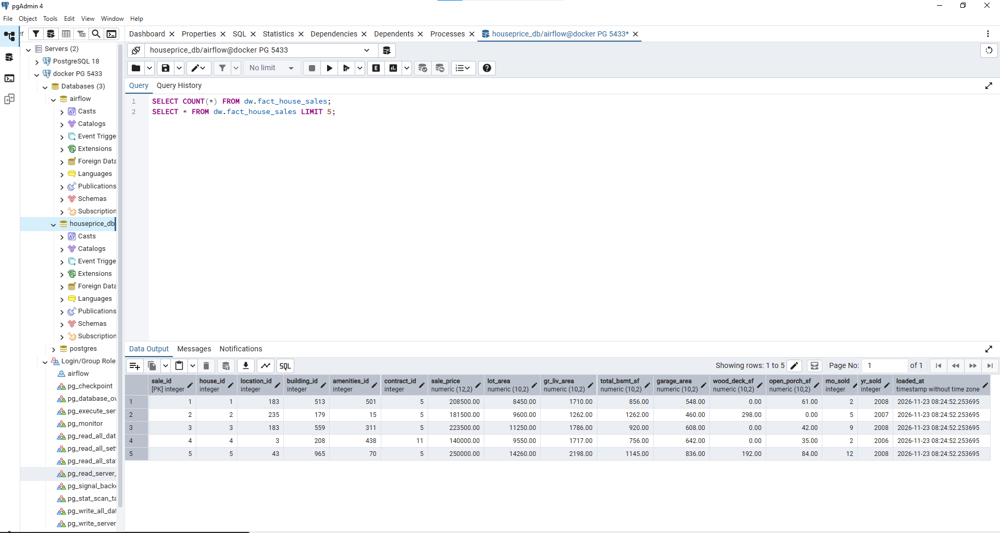
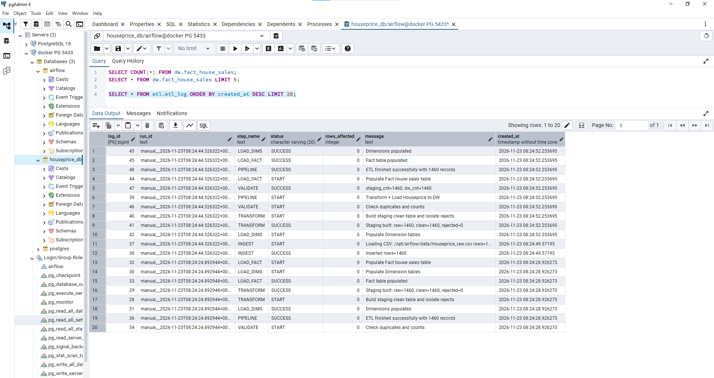

# Kết quả chấm Final Project – houseprice / project_mindx_02

Tổng điểm: **6.5 / 10**  (Bonus: Chưa có dữ liệu để chấm)  
Độ tin cậy: **Trung bình** – chưa chạy Docker thật; bảng log, idempotent và post_run_check chưa được xác nhận bằng thực thi. Repo chưa có Git (không có `.git/`) nên không kiểm tra được lịch sử commit, `.gitignore`, và file bị track lỡ.

---

## Bảng điểm

| Tiêu chí | Mức | Điểm | Bằng chứng chính |
|---|---|---|---|
| 1. Pipeline tự động hoá | Trung bình | 1.5 | DAG có đủ task, retries=2, nhưng user/password hard-code làm giá trị mặc định `os.getenv("DB_PASS","airflow")` trong cả 3 script và trong `docker-compose.yaml` environment → vi phạm B5; không tìm thấy `.env.example` và không có Airflow Connection |
| 2. Data Cleaning & Validation | Khá | 1.5 | Raw TEXT ✓, dedup `DISTINCT ON … ORDER BY raw_id DESC` ✓, ép kiểu an toàn `CASE WHEN ~ regex` ✓, validate trước commit ✓; thiếu bảng reject/log số dòng bị loại, không log `rejected_cnt` |
| 3. Logging & Monitoring | Khá | 1.5 | Bảng `etl.etl_log` có đủ cột `run_id, step_name, status, message, created_at` ✓; ghi FAIL sau rollback ✓; nhưng `RUN_ID` tạo độc lập trong từng script (không nhất quán xuyên task), không log số dòng vào/ra, `post_run_check` không ghi vào `etl_log` |
| 4. Kiểm tra kết quả | Khá | 0.8 | README có SQL kiểm tra COUNT, fact, dim, etl_log ✓; `etl_houseprice_transform_load.py` có validate 3 chiều (dup, price, staging vs dw) ✓; `post_run_check.py` kiểm tra orphan FK ✓; nhưng không có ảnh chụp kết quả, `post_run_check` không ghi vào `etl_log`, chưa có file SQL check riêng |
| 5. Hồ sơ nộp project | Khá | 0.8 | Có DAG, scripts, docker-compose, sql init, CSV ✓; `__pycache__/` được track (không có `.gitignore`); repo chưa là git repository (`git status` = "not a git repository") |
| 6. Tài liệu & Git | Trung bình | 0.5 | README có lệnh chạy, URL, tài khoản, SQL kiểm tra ✓; nhưng **không có `.gitignore`**, **repo chưa là git** (chưa `git init` / chưa có `.git`), không có ảnh chụp màn hình, không có commit nào |

**Tổng: 1.5 + 1.5 + 1.5 + 0.8 + 0.8 + 0.5 = 6.5 / 10**

---

## Checklist theo tiêu chí

**TC1 – Pipeline tự động hoá**
- B1 Đạt – `houseprice_e2e_csv_to_dw_dag.py` parse được, có `dag_id`, `start_date=days_ago(1)`, `schedule_interval=None`, `catchup=False`
- B2 Đạt – 4 task: `start → ingest_csv_to_raw → transform_load_dw → post_run_check → end`; thứ tự `>>` đúng; ingest và transform tách riêng thành 2 BashOperator
- B3 Đạt – không có `trigger_rule` đảo ngược; các script `sys.exit(1)` khi lỗi
- B4 Một phần – `etl_houseprice_transform_load.py` có `TRUNCATE TABLE dw.fact_house_sales CASCADE` và dim TRUNCATE trước load → idempotent cho DW; nhưng `load_csv_to_postgres_raw.py` cũng có `TRUNCATE TABLE raw.houseprice_raw` → idempotent raw ✓. Cần chạy thật để xác nhận.
- **B5 Không đạt** – `etl_houseprice_transform_load.py:21` `env("DB_PASS", "airflow")`, `post_run_check.py:11` `env("DB_PASS", "airflow")`, `load_csv_to_postgres_raw.py:30` `env("DB_PASS", "airflow")`. Cả 3 script và `docker-compose.yaml` environment có `DB_PASS: airflow` viết thẳng. Không có `.env.example`, không có Airflow Connection.
- B6 Chưa kiểm chứng – cần chạy thật trên Docker
- N1 Đạt – `retries=2`, `retry_delay=timedelta(minutes=1)` trong `default_args`
- N2 Không đạt – không có `on_failure_callback`
- N3 Không đạt – không có `healthcheck`/`depends_on` cho Airflow chờ Postgres sẵn sàng
- N5 Đạt – transform và load dim/fact tách trong ETL script; check là task riêng

**TC2 – Data Cleaning & Validation**
- B1 Đạt – `raw.houseprice_raw` toàn TEXT, 81 cột; `TRUNCATE` trước ingest giữ schema nguyên
- B2 Đạt – xử lý null/rỗng (`COALESCE/NULLIF`), sai kiểu (`CASE WHEN ~ regex`), giá trị âm (`sale_price > 0`), `payment_method` → bảng này không có `payment_method` nhưng có cột phân loại tương đương (`sale_condition, sale_type, ms_zoning`), dedup `DISTINCT ON (house_id) ORDER BY raw_id DESC`
- B3 Đạt – regex `~` trước khi ép kiểu; dữ liệu bẩn không làm fail
- B4 Đạt – toàn bộ clean bằng SQL CTE `parsed → dedup → cleaned`; Python chỉ gọi `cur.execute(SQL_BUILD_STAGING)`
- B5 Đạt – validate trước `conn.commit()`: kiểm tra dup, price, staging vs dw count
- N1 Không đạt – không có bảng reject/quarantine
- N2 Không đạt – không log số dòng bị loại (`rejected_cnt`)
- N3 Một phần – `sale_price NUMERIC(12,2) NOT NULL CHECK (sale_price > 0)` ✓; `PRIMARY KEY` trên staging ✓
- N4 Đạt – dedup có `ORDER BY house_id, raw_id DESC` rõ ràng
- N5 Đạt – `TRIM` và `COALESCE` cho các cột text

**TC3 – Logging & Monitoring**
- B1 Đạt – `etl.etl_log` có `CREATE TABLE` trong `sql/01_setup_houseprice_db.sql`; script `INSERT` vào bảng này
- B2 Một phần – `etl_houseprice_transform_load.py` log TRANSFORM, LOAD_DIMS, LOAD_FACT, VALIDATE, PIPELINE; `load_csv_to_postgres_raw.py` log INGEST; nhưng `post_run_check.py` **không ghi** vào `etl_log`
- B3 Đạt – cả 2 script: `conn.rollback()` trước, rồi `conn.autocommit = True` và ghi FAIL riêng
- B4 Chưa kiểm chứng – README có câu SQL `SELECT * FROM etl.etl_log ORDER BY created_at DESC LIMIT 20` ✓; cần vấn đáp để xác nhận học viên giải thích được
- N1 Không đạt – không log số dòng vào/ra từng bước
- N2 Không đạt – mỗi script tạo `RUN_ID = f"RUN_{uuid.uuid4().hex[:8]}"` riêng; sau một lần trigger có 2 `RUN_ID` khác nhau trong `etl_log`
- N3 Không đạt – không dùng module `logging`
- N4 Không đạt – không có câu query mẫu xem log mới nhất (README chỉ có câu tổng quát)

**TC4 – Kiểm tra kết quả**
- B1 Đạt – README có `SELECT COUNT(*) FROM raw.houseprice_raw`, `SELECT COUNT(*) FROM dw.fact_house_sales`, `SELECT * FROM etl.etl_log …`
- B2 Một phần – có SQL kiểm tra ✓; không có ảnh chụp kết quả thật
- N1 Một phần – `post_run_check.py` kiểm tra giá âm, orphan FK, dw_cnt=0; không có đối soát `raw − reject = DW`
- N2 Một phần – `post_run_check.py` có `sys.exit(1)` khi lỗi → Airflow đánh dấu FAIL ✓; nhưng không ghi vào `etl_log`
- N3 Chưa kiểm chứng – cần vấn đáp

**TC5 – Hồ sơ nộp project**
- B1 Đạt – `dags/houseprice_e2e_csv_to_dw_dag.py`, `dags/scripts/`, `docker-compose.yaml` đều có
- B2 Đạt – `sql/00_init_create_houseprice_db.sql` và `sql/01_setup_houseprice_db.sql` mount qua `./sql:/docker-entrypoint-initdb.d`; `data/Houseprice_raw.csv` tại đúng `CSV_PATH`
- B3 Chưa kiểm chứng – cần chạy thật; `__pycache__` được track là rác nhưng không ảnh hưởng chạy
- B4 Đạt – dùng bảng **Houseprice (Ames Housing)**, không phải bảng `sales` mẫu lớp
- N1 Không đạt – `dags/scripts/__pycache__/` và `dags/__pycache__/` được track (không có `.gitignore`)

**TC6 – Tài liệu & Git**
- B1 Đạt – README có mô tả, lệnh chạy, URL `http://localhost:8080`, tài khoản `admin/admin`, SQL kiểm tra
- B2 Không đạt – **không có ảnh chụp màn hình** nào trong repo
- B3 Không đạt – **không có `.gitignore`**; `__pycache__` đang được track
- B4 Không đạt – **repo chưa là git repository** (`fatal: not a git repository`); không có commit nào
- B5 Đạt – port README (`5433`) khớp `docker-compose.yaml` (`"5433:5432"`), tên DAG khớp
- N1 Không đạt – không có mục troubleshooting

---

## Điểm mạnh & việc đã làm được

| Tiêu chí | Việc học viên đã làm tốt | Bằng chứng (file/task/dòng) | Liên hệ bài học |
|---|---|---|---|
| TC1 | Task `ingest` và `transform_load` tách riêng thành 2 BashOperator; DAG có `retries=2`, `retry_delay=1m`, `catchup=False` | `houseprice_e2e_csv_to_dw_dag.py:34-56`, `default_args` | L11 "một task một việc"; retry (L12 s7) |
| TC2 | Toàn bộ cleaning bằng SQL CTE 3 lớp (`parsed → dedup → cleaned`); dedup `DISTINCT ON (house_id) ORDER BY raw_id DESC` đúng nguyên tắc; ép kiểu an toàn hoàn toàn bằng regex trước khi cast; `sale_price NUMERIC(12,2) CHECK (sale_price > 0)` | `etl_houseprice_transform_load.py:SQL_BUILD_STAGING` | L7 set-based, L2 kiểu dữ liệu |
| TC2 | Validate trước `conn.commit()`: kiểm tra duplicate key, giá trị price âm/null, và đối chiếu staging vs DW count | `etl_houseprice_transform_load.py:150-172` | L10 s21 "validation trước commit" |
| TC3 | Ghi log FAIL sau `rollback` đúng cách: `conn.rollback()` → `conn.autocommit=True` → `INSERT` FAIL | `etl_houseprice_transform_load.py:178-183`, `load_csv_to_postgres_raw.py:118-123` | L10 "rollback trước log FAIL" |
| TC3 | Bảng `etl.etl_log` đầy đủ cột `run_id, step_name, status, rows_affected, message, created_at` | `sql/01_setup_houseprice_db.sql:150-158` | L10 s16–17 |
| TC4 | `post_run_check.py` kiểm tra orphan FK (location/building/amenities/contract NULL), giá âm, và dw_cnt=0; `sys.exit(1)` khi fail | `post_run_check.py:52-70` | L12 s13–15 |
| TC5 | Star schema đầy đủ: 1 fact + 4 dimension; SQL init mount vào Postgres qua `initdb.d`; CSV đúng đường dẫn | `sql/01_setup_houseprice_db.sql`, `docker-compose.yaml:volumes` | L11 s27 |
| TC6 | README rõ ràng: lệnh `docker compose up airflow-init`, URL, tài khoản, SQL kiểm tra, lệnh reset `down -v`; port README (5433) khớp compose | `README.md` | L12 s14 |

---

## Điểm chưa đúng & cách sửa

### [Nghiêm trọng] Hard-code user/password trong code – Tiêu chí 1 (B5)

- **Chỗ sai:**
  - `dags/scripts/etl_houseprice_transform_load.py:22` → `"password": env("DB_PASS", "airflow")`
  - `dags/scripts/post_run_check.py:11` → `v = os.getenv(name) ... return default` (hàm `env` luôn fallback về `"airflow"`)
  - `dags/scripts/load_csv_to_postgres_raw.py:30` → `"password": env("DB_PASS", "airflow")`
  - `docker-compose.yaml:14` → `DB_PASS: airflow` viết thẳng trong `environment`
- **Vì sao sai:** Giảng viên quy định tuyệt đối không để user/password trong code, kể cả làm giá trị mặc định của `os.getenv`. Nếu thiếu biến môi trường, pipeline phải báo lỗi ngay để người vận hành biết cần cấu hình, không được âm thầm dùng mật khẩu mặc định. (L9; TC1 B5; vi phạm này giới hạn TC1 tối đa Trung bình)
- **Cách sửa, làm theo thứ tự:**
  1. Tạo file `.env.example` ở gốc repo (commit file này, **không** commit `.env` thật):
     ```
     DB_HOST=postgres
     DB_PORT=5432
     DB_NAME=houseprice_db
     DB_USER=change_me
     DB_PASS=change_me
     CSV_PATH=/opt/airflow/data/Houseprice_raw.csv
     ```
  2. Tạo file `.env` thật (copy từ example, không commit):
     ```bash
     cp .env.example .env
     # Sửa DB_USER và DB_PASS trong .env thành giá trị thật
     ```
  3. Mở `dags/scripts/etl_houseprice_transform_load.py`, **xoá giá trị mặc định** cho user/password trong hàm `env` và dict `DB`:
     ```python
     # Trước:
     "user": env("DB_USER", "airflow"),
     "password": env("DB_PASS", "airflow"),
     
     # Sau: (không có default → raise nếu thiếu biến)
     "user": env("DB_USER"),
     "password": env("DB_PASS"),
     ```
  4. Làm tương tự cho `dags/scripts/post_run_check.py` và `dags/scripts/load_csv_to_postgres_raw.py` (xoá giá trị mặc định `"airflow"` ở `DB_USER` và `DB_PASS`).
  5. Mở `docker-compose.yaml`, **xoá** các dòng `DB_USER: airflow` và `DB_PASS: airflow` trong mục `environment` của `x-airflow-common`; thay bằng đọc từ file env:
     ```yaml
     x-airflow-common:
       &airflow-common
       environment:
         # ... giữ các biến AIRFLOW__ ...
         DB_HOST: postgres
         DB_PORT: "5432"
         DB_NAME: houseprice_db
         DB_USER: ${DB_USER}      # đọc từ .env
         DB_PASS: ${DB_PASS}      # đọc từ .env
         CSV_PATH: /opt/airflow/data/Houseprice_raw.csv
       env_file:
         - .env
     ```
  6. Thêm vào `README.md` mục cài đặt trước khi chạy:
     ```markdown
     ## Cài đặt lần đầu
     ```bash
     cp .env.example .env
     # Mở .env, sửa DB_USER và DB_PASS
     ```
     ```
  7. Commit:
     ```bash
     git add .env.example docker-compose.yaml dags/scripts/ README.md
     git commit -m "fix: remove hardcoded credentials, use .env file"
     ```
- **Cách kiểm tra đã sửa đúng:** Chạy `grep -rn "\"airflow\"" dags/scripts/` → không còn kết quả liên quan đến password. Xoá `.env`, chạy `docker compose up -d`, task INGEST phải fail với lỗi "Missing env var: DB_PASS" thay vì âm thầm chạy với password mặc định. Cần chạy thật để xác nhận.
- **Được thêm:** TC1 từ Trung bình lên **Khá** (+0.5đ). Nếu thêm cả N1 (retries đã có) thì có thể lên Tốt nếu không còn lỗi nào khác.

---

### [Nghiêm trọng] Repo chưa là Git repository – Tiêu chí 6 (B3, B4)

- **Chỗ sai:** Thư mục `D:\project_mindx_02` không có `.git/`. Lệnh `git status` trả về `fatal: not a git repository`. Không có commit nào, không có `.gitignore`.
- **Vì sao sai:** Đề bài yêu cầu "đưa lên git"; giảng viên chấm dựa trên commit history và `.gitignore` để đánh giá quá trình làm việc. (TC6 B3, B4)
- **Cách sửa, làm theo thứ tự:**
  1. Tạo file `.gitignore` ở gốc repo `D:\project_mindx_02\.gitignore`:
     ```
     logs/
     __pycache__/
     *.pyc
     *.pyo
     .env
     .DS_Store
     *.egg-info/
     dist/
     build/
     ```
  2. Khởi tạo git và commit lần đầu:
     ```bash
     cd D:\project_mindx_02
     git init
     git add .gitignore .env.example docker-compose.yaml README.md sql/ dags/houseprice_e2e_csv_to_dw_dag.py dags/scripts/ data/Houseprice_raw.csv
     git commit -m "feat: initial project structure with DAG, SQL init, and docker-compose"
     ```
     Lưu ý: **không** `git add logs/`, **không** `git add dags/scripts/__pycache__/`.
  3. Tạo repo trên GitHub (hoặc GitLab), rồi push:
     ```bash
     git remote add origin <URL_REPO>
     git push -u origin main
     ```
- **Cách kiểm tra đã sửa đúng:** `git log --oneline` hiển thị ít nhất 1 commit. `git ls-files | Select-String "pycache"` → không có kết quả. `git ls-files | Select-String "^logs"` → không có kết quả.
- **Được thêm:** TC6 từ Trung bình lên **Khá** (+0.2đ).

---

### [Trung bình] `post_run_check` không ghi vào `etl_log` – Tiêu chí 3 (B2), Tiêu chí 4

- **Chỗ sai:** `dags/scripts/post_run_check.py` hoàn toàn không có `INSERT INTO etl.etl_log`. Bước CHECK không xuất hiện trong bảng log sau khi DAG chạy.
- **Vì sao sai:** TC3 B2 yêu cầu log đủ tất cả bước ingest, transform, load, validate, và pipeline success/fail. `post_run_check` là bước kiểm tra cuối pipeline nhưng không để lại dấu vết trong DB. (L10 s16–17)
- **Cách sửa, làm theo thứ tự:**
  1. Mở `dags/scripts/post_run_check.py`. Thêm import và hằng số ở đầu file:
     ```python
     import uuid
     RUN_ID = os.getenv("RUN_ID") or f"RUN_{uuid.uuid4().hex[:8]}"
     SQL_LOG = "INSERT INTO etl.etl_log(run_id, step_name, status, message) VALUES (%s,%s,%s,%s);"
     ```
  2. Trong `main()`, sau khi tạo `conn`, thêm log START:
     ```python
     with conn.cursor() as cur:
         cur.execute(SQL_LOG, (RUN_ID, "CHECK", "START", "Post-run data quality check"))
     conn.commit()
     ```
  3. Sau khi tất cả kiểm tra pass, thêm log SUCCESS trước khi print:
     ```python
     with conn.cursor() as cur:
         cur.execute(SQL_LOG, (RUN_ID, "CHECK", "SUCCESS",
             f"raw={raw_cnt}, dw={dw_cnt}, total_sales={float(total_sales):,.2f}"))
     conn.commit()
     ```
  4. Trong mệnh đề `except`, thêm log FAIL trước `sys.exit(1)`:
     ```python
     except Exception as e:
         try:
             with conn.cursor() as cur:
                 cur.execute(SQL_LOG, (RUN_ID, "CHECK", "FAIL", str(e)))
             conn.commit()
         except Exception:
             pass
         print(f"CHECK FAILED | ERROR={e}")
         sys.exit(1)
     ```
  5. Commit: `git commit -m "fix: post_run_check now writes to etl_log"`
- **Cách kiểm tra đã sửa đúng:** Trigger DAG, sau đó chạy `SELECT step_name, status FROM etl.etl_log ORDER BY created_at DESC LIMIT 10;` → phải thấy dòng `CHECK | SUCCESS`. Cần chạy thật để xác nhận.
- **Được thêm:** TC3 B2 đạt đầy đủ, hỗ trợ nâng mức TC3 lên Tốt khi kết hợp với sửa RUN_ID.

---

### [Trung bình] `RUN_ID` không nhất quán giữa các task – Tiêu chí 3 (N2)

- **Chỗ sai:** `load_csv_to_postgres_raw.py:9` → `RUN_ID = f"RUN_{uuid.uuid4().hex[:8]}"` và `etl_houseprice_transform_load.py:9` → tương tự. Mỗi script tự sinh UUID riêng → sau một lần trigger DAG, bảng `etl_log` có 2 (hoặc 3) `RUN_ID` khác nhau, không thể truy vết một lần chạy từ đầu đến cuối.
- **Vì sao sai:** Không thể dùng `SELECT * FROM etl.etl_log WHERE run_id = ?` để xem toàn bộ log một pipeline run. (L10 s16; TC3 N2)
- **Cách sửa, làm theo thứ tự:**
  1. Mở `dags/houseprice_e2e_csv_to_dw_dag.py`. Trong mỗi `BashOperator`, thêm biến `RUN_ID` vào dict `env`:
     ```python
     DB_ENV = {
         ...,
         "RUN_ID": "{{ run_id }}",   # Jinja template, Airflow tự điền
     }
     ```
     Và thêm `append_env=True` vào mỗi BashOperator để không ghi đè toàn bộ env:
     ```python
     ingest = BashOperator(
         task_id="ingest_csv_to_raw",
         bash_command=f'{PYTHON} "{INGEST_SCRIPT}"',
         env=DB_ENV,
         append_env=True,
     )
     # làm tương tự cho transform_load và check
     ```
  2. Trong `load_csv_to_postgres_raw.py` và `etl_houseprice_transform_load.py`, thay dòng sinh UUID:
     ```python
     # Trước:
     RUN_ID = f"RUN_{uuid.uuid4().hex[:8]}"
     
     # Sau:
     RUN_ID = os.getenv("RUN_ID") or f"RUN_{uuid.uuid4().hex[:8]}"
     ```
  3. Commit: `git commit -m "fix: use Airflow run_id for consistent ETL log tracing"`
- **Cách kiểm tra đã sửa đúng:** Trigger DAG một lần, chạy `SELECT DISTINCT run_id FROM etl.etl_log;` → chỉ có **1 giá trị**. Cần chạy thật để xác nhận.
- **Được thêm:** Hỗ trợ nâng TC3 lên Tốt (+0.5đ tổng cộng khi kết hợp với sửa log post_run_check và log số dòng).

---

### [Trung bình] Không có ảnh chụp màn hình – Tiêu chí 6 (B2)

- **Chỗ sai:** Toàn bộ repo không có file ảnh nào. Mục "Kiểm tra kết quả" trong README chỉ có SQL query, không có bằng chứng thực tế.
- **Vì sao sai:** TC6 B2 bắt buộc có ảnh chụp DAG success, dữ liệu DW, và log. Học viên cần chứng minh đã chạy thành công. (đề bài; TC6 B2)
- **Cách sửa, làm theo thứ tự:**
  1. Chạy project: `docker compose up airflow-init` → chờ xong → `docker compose up -d`.
  2. Mở [http://localhost:8080](http://localhost:8080), đăng nhập `admin/admin`, trigger DAG `houseprice_e2e_csv_to_dw`.
  3. Chờ DAG xanh hoàn toàn. Chụp **3 ảnh** và lưu vào thư mục `docs/`:
     - `docs/01_dag_graph.png`: tab **Graph** của DAG, tất cả task xanh. Nhìn rõ tên task.
     - `docs/02_dw_data.png`: kết quả `SELECT COUNT(*) FROM dw.fact_house_sales;` và `SELECT * FROM dw.fact_house_sales LIMIT 5;` trong pgAdmin/DBeaver/psql.
     - `docs/03_etl_log.png`: kết quả `SELECT * FROM etl.etl_log ORDER BY created_at DESC LIMIT 20;` thấy các bước INGEST, TRANSFORM, VALIDATE, PIPELINE.
  4. Thêm vào `README.md` ngay sau mục "Kiểm tra kết quả":
     ```markdown
     ### Bằng chứng chạy thành công
     
     
     
     ```
  5. Commit: `git add docs/ README.md && git commit -m "docs: add screenshots of successful DAG run"`
- **Cách kiểm tra đã sửa đúng:** Mở README trên GitHub, 3 ảnh hiển thị, không bị broken link.
- **Được thêm:** TC6 từ Trung bình lên Khá (+0.2đ).

---

### [Nhẹ] Không có bảng reject / không log số dòng bị loại – Tiêu chí 2 (N1, N2)

- **Chỗ sai:** `etl_houseprice_transform_load.py:SQL_BUILD_STAGING` – staging clean được build bằng CTE `dedup + cleaned` nhưng không có INSERT vào bảng reject; hàm `log()` không ghi số dòng bị lọc.
- **Vì sao sai:** Không biết bao nhiêu dòng bị loại (null sale_price, dedup). Khi dữ liệu thay đổi, không có cách audit. (L7 s16; TC2 N1, N2)
- **Cách sửa, làm theo thứ tự:**
  1. Thêm bảng reject vào `sql/01_setup_houseprice_db.sql` (trước phần GRANT):
     ```sql
     DROP TABLE IF EXISTS etl.houseprice_reject CASCADE;
     CREATE TABLE etl.houseprice_reject (
         reject_id BIGSERIAL PRIMARY KEY,
         raw_id BIGINT,
         reason TEXT,
         rejected_at TIMESTAMP DEFAULT CURRENT_TIMESTAMP
     );
     GRANT ALL ON TABLE etl.houseprice_reject TO airflow;
     GRANT ALL ON SEQUENCE etl.houseprice_reject_reject_id_seq TO airflow;
     ```
  2. Trong `etl_houseprice_transform_load.py`, sau `cur.execute(SQL_BUILD_STAGING)`, thêm SQL đếm và insert reject:
     ```python
     cur.execute("""
         SELECT 
             (SELECT COUNT(*) FROM raw.houseprice_raw) AS raw_cnt,
             (SELECT COUNT(*) FROM etl.houseprice_staging_clean) AS clean_cnt
     """)
     raw_cnt, clean_cnt = cur.fetchone()
     rejected_cnt = raw_cnt - clean_cnt
     
     cur.execute("""
         INSERT INTO etl.houseprice_reject(raw_id, reason)
         SELECT r.raw_id, 'invalid or duplicate'
         FROM raw.houseprice_raw r
         WHERE NOT EXISTS (
             SELECT 1 FROM etl.houseprice_staging_clean s WHERE s.house_id::TEXT = r.id
         );
     """)
     log(cur, "TRANSFORM", "SUCCESS", 
         f"raw={raw_cnt}, clean={clean_cnt}, rejected={rejected_cnt}")
     ```
  3. Reset DB: `docker compose down -v && docker compose up airflow-init && docker compose up -d`.
  4. Commit: `git commit -m "feat: add reject table and log row counts in transform step"`
- **Cách kiểm tra đã sửa đúng:** `SELECT * FROM etl.houseprice_reject LIMIT 10;` hiện các dòng bị loại. `SELECT message FROM etl.etl_log WHERE step_name='TRANSFORM' AND status='SUCCESS';` hiện `raw=X, clean=Y, rejected=Z`.
- **Được thêm:** TC2 N1+N2 đạt → hỗ trợ nâng TC2 lên Tốt.

---

### [Nhẹ] `docker-compose.yaml` không có `healthcheck` / `depends_on` cho Postgres – Tiêu chí 1 (N3)

- **Chỗ sai:** `docker-compose.yaml` – `airflow-webserver` và `airflow-scheduler` chỉ có `depends_on: - postgres` nhưng không kiểm tra Postgres đã thực sự sẵn sàng nhận kết nối. Nếu Postgres khởi động chậm, Airflow có thể fail khi connect.
- **Vì sao sai:** `depends_on` chỉ chờ container start, không chờ Postgres healthy. (L11 s27; TC1 N3)
- **Cách sửa, làm theo thứ tự:**
  1. Mở `docker-compose.yaml`, thêm `healthcheck` vào service `postgres`:
     ```yaml
     postgres:
       image: postgres:15
       environment:
         POSTGRES_USER: airflow
         POSTGRES_PASSWORD: airflow
         POSTGRES_DB: airflow
       healthcheck:
         test: ["CMD-SHELL", "pg_isready -U airflow"]
         interval: 10s
         timeout: 5s
         retries: 5
       volumes:
         - postgres-db-volume:/var/lib/postgresql/data
         - ./sql:/docker-entrypoint-initdb.d
       ports:
         - "5433:5432"
     ```
  2. Sửa `depends_on` trong `x-airflow-common`:
     ```yaml
     depends_on:
       postgres:
         condition: service_healthy
     ```
  3. Commit: `git commit -m "feat: add postgres healthcheck and depends_on condition"`
- **Cách kiểm tra đã sửa đúng:** `docker compose up -d` → `docker compose ps` → cột `STATUS` của `postgres` hiện `healthy` trước khi Airflow bắt đầu.
- **Được thêm:** TC1 N3 đạt, hỗ trợ nâng lên Tốt khi kết hợp với sửa B5.

---

## Điểm cần cải thiện (xếp theo lợi ích điểm)

1. **Sửa hard-code credentials (TC1 B5)** → TC1 từ Trung bình lên Khá **(+0.5đ)**. Đây là lỗi nghiêm trọng nhất và cũng dễ sửa nhất – thêm `.env.example`, xoá default `"airflow"` trong 3 script và compose.

2. **Khởi tạo Git + tạo `.gitignore` + push lên GitHub (TC6 B3, B4)** → TC6 từ Trung bình lên Khá **(+0.2đ)**. Chạy `git init`, thêm `.gitignore`, commit từng phần có ý nghĩa.

3. **Thêm ảnh chụp màn hình vào README (TC6 B2)** → Hỗ trợ TC6 lên Khá/Tốt. Cần chạy Docker xong mới chụp được.

4. **Thêm log vào `post_run_check.py` + sửa `RUN_ID` nhất quán (TC3 N2)** → Nâng TC3 lên Tốt **(+0.5đ)**. Kết hợp cả 2 sửa này cùng thêm log số dòng.

5. **Thêm bảng reject + log `rejected_cnt` (TC2 N1, N2)** → Nâng TC2 lên Tốt **(+0.5đ)**. Cần reset DB sau khi thêm bảng mới.

**Tổng có thể đạt sau khi sửa (ước tính): 7.9–8.5 / 10** (phụ thuộc vào xác nhận chạy thật)

Kiến thức nên ôn:
- Quản lý secret: L9 (không hard-code, dùng env/vault), L12 s8 (lỗi phổ biến hard-code)
- Git workflow: `git init`, `.gitignore`, commit message có ý nghĩa, không track file rác
- Logging nhất quán: L10 s16–17 (run_id xuyên suốt, log số dòng, rollback trước log FAIL)

---

## Câu hỏi vấn đáp gợi ý (phần AI chưa kiểm chứng được)

1. Chạy `docker compose up airflow-init` xong bạn thấy gì? Nếu báo lỗi "database houseprice_db không tồn tại" thì xử lý thế nào?
2. Trigger DAG lần 2 ngay sau lần 1 – số dòng trong `dw.fact_house_sales` thay đổi không? Vì sao đảm bảo được điều đó?
3. Bảng `etl.etl_log` lưu gì? Nếu task `transform_load_dw` fail, em tra log thế nào để biết lỗi xảy ra ở bước nào?
4. Hàm `env()` trong code hiện tại hoạt động ra sao khi biến môi trường không tồn tại? Tại sao cách đó có vấn đề về bảo mật?
5. Nếu file CSV có 10 dòng có `saleprice = 'N/A'`, pipeline xử lý thế nào? Những dòng đó đi đâu?
6. `LEFT JOIN` khi load fact có thể để lại `location_id = NULL` trong fact không? Khi nào điều đó xảy ra?

---

## Lưu ý cho giảng viên

1. **B5 (credentials):** Điểm Trung bình ở TC1 do vi phạm B5 là điểm trừ nặng nhất. Cân nhắc nếu học viên sửa được trong buổi vấn đáp thì có thể nâng điểm TC1.
2. **Repo chưa là Git:** Thư mục `project_mindx_02` không có `.git/` – học viên chưa `git init` hoặc clone về nhưng thiếu cờ. TC6 bị ảnh hưởng toàn bộ B3/B4. Yêu cầu học viên push lên GitHub trước khi vấn đáp.
3. **Idempotent (B4):** Code có `TRUNCATE` trước load → logic đúng; chưa xác nhận được vì chưa chạy Docker. Hỏi vấn đáp.
4. **Rubric TC5 Khá = 0.8 vs TC6 Khá = 0.7:** Giữ nguyên theo Excel như rubric quy định.
5. **Chủ đề dữ liệu:** Dùng **Ames Housing / Houseprice dataset**, không phải bảng `sales` mẫu lớp → đạt yêu cầu chọn bảng riêng.

---

*Báo cáo lưu tại: `D:\project_mindx_02\cham_diem_houseprice.md`*
