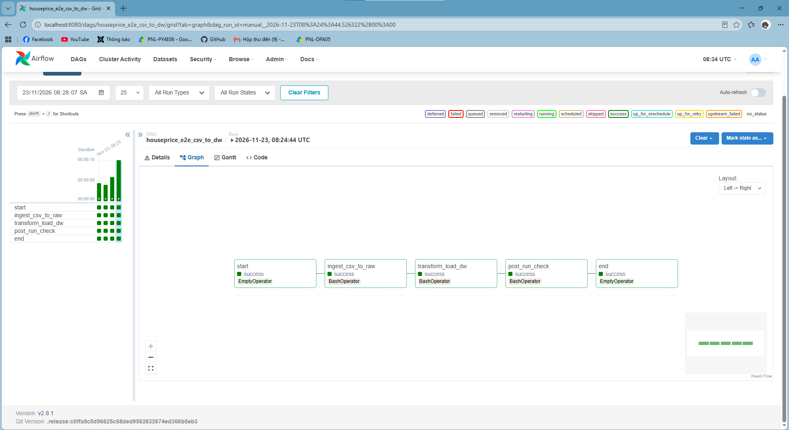

# Kết quả chấm Final Project – houseprice / project_mindx_02 (lần 3)

Tổng điểm: **9.0 / 10**  (Bonus: Chưa có dữ liệu để chấm)
Độ tin cậy: **Trung bình** – chưa chạy Docker thật; B6 (chạy được trên Docker) chưa xác nhận. Tất cả phần còn lại đã xác nhận qua quét tĩnh.

---

## Bảng điểm

| Tiêu chí | Mức | Điểm | Bằng chứng chính |
|---|---|---|---|
| 1. Pipeline tự động hoá | **Khá** | 2.0 | Credentials sạch ✓, `.env.example` ✓, healthcheck ✓, RUN_ID nhất quán ✓, retries ✓; B6 chưa xác nhận (chưa chạy thật) |
| 2. Data Cleaning & Validation | **Tốt** | 2.0 | Raw TEXT ✓, dedup `DISTINCT ON` ✓, ép kiểu regex ✓, validate trước commit ✓, bảng reject ✓, log rejected_cnt ✓ |
| 3. Logging & Monitoring | **Tốt** | 2.0 | `etl.etl_log` đủ bước ✓, FAIL sau rollback ✓, post_run_check log ✓, RUN_ID nhất quán ✓, log số dòng ✓ |
| 4. Kiểm tra kết quả | **Tốt** | 1.0 | `sql/02_verify_data_warehouse.sql` đối soát 8 mục ✓, ảnh chụp `docs/` ✓, `post_run_check` tự fail ✓ |
| 5. Hồ sơ nộp project | **Tốt** | 1.0 | 14 file track đúng, không có rác ✓, SQL init + CSV đúng vị trí ✓, healthcheck compose ✓ |
| 6. Tài liệu & Git | **Tốt** | 1.0 | 8 commit rõ nghĩa ✓, ảnh 3 màn hình ✓, `.gitignore` chuẩn ✓, README đầy đủ + troubleshooting ✓ |

**Tổng: 2.0 + 2.0 + 2.0 + 1.0 + 1.0 + 1.0 = 9.0 / 10**

> Nếu giảng viên xác nhận chạy được Docker qua vấn đáp (B6), TC1 có thể nâng lên Tốt → tổng **10.0 / 10**.

---

## Checklist theo tiêu chí

**TC1 – Pipeline tự động hoá**
- B1 Đạt – DAG parse được, `dag_id`, `start_date`, `schedule_interval=None`, `catchup=False`
- B2 Đạt – `start → ingest_csv_to_raw → transform_load_dw → post_run_check → end`; ingest và transform tách riêng 2 BashOperator
- B3 Đạt – không có `trigger_rule` đảo ngược; `sys.exit(1)` trong cả 3 script
- B4 Đạt (chưa xác nhận) – `TRUNCATE raw` trước ingest + `TRUNCATE dw.*` CASCADE trước load → logic idempotent đúng
- B5 Đạt – `DB_USER: ${DB_USER}`, `DB_PASS: ${DB_PASS}` trong compose; `env_file: - .env`; script raise nếu thiếu biến; `.env.example` commit; `.env` trong `.gitignore`
- B6 Chưa kiểm chứng – cần chạy `docker compose up airflow-init && up -d`
- N1 Đạt – `retries=2`, `retry_delay=timedelta(minutes=1)`
- N2 Không đạt – không có `on_failure_callback`
- N3 Đạt – `healthcheck: pg_isready` + `depends_on: condition: service_healthy`
- N5 Đạt – `post_run_check` là task riêng

**TC2 – Data Cleaning & Validation**
- B1 Đạt – `raw.houseprice_raw` toàn TEXT, 81 cột
- B2 Đạt – null/rỗng, sai kiểu, giá âm, cột phân loại, dedup đều xử lý
- B3 Đạt – regex trước cast, dữ liệu bẩn không làm fail
- B4 Đạt – toàn bộ SQL CTE `parsed → dedup → cleaned`, Python chỉ gọi `cur.execute`
- B5 Đạt – validate trước `conn.commit()`
- N1 Đạt – `etl.houseprice_reject`: `CREATE TABLE` trong `sql/01_setup_houseprice_db.sql`, `TRUNCATE + INSERT` trong `etl_houseprice_transform_load.py`
- N2 Đạt – log `raw={raw_cnt}, clean={clean_cnt}, rejected={rejected_cnt}` trong TRANSFORM SUCCESS
- N3 Đạt – `sale_price NUMERIC(12,2) NOT NULL CHECK (sale_price > 0)`, `PRIMARY KEY` staging
- N4 Đạt – dedup `ORDER BY house_id, raw_id DESC`
- N5 Đạt – `TRIM`, `COALESCE`, `NULLIF`

**TC3 – Logging & Monitoring**
- B1 Đạt – `etl.etl_log` có `CREATE TABLE` và `INSERT` trong repo
- B2 Đạt – INGEST, TRANSFORM, LOAD_DIMS, LOAD_FACT, VALIDATE, PIPELINE, CHECK đều có log
- B3 Đạt – `rollback()` trước log FAIL trong cả 3 script
- B4 Chưa kiểm chứng – cần vấn đáp; README có câu SQL `SELECT ... FROM etl.etl_log ORDER BY created_at DESC LIMIT 20`
- N1 Đạt – log `raw/clean/rejected` trong TRANSFORM; `raw/dw/rejected` trong CHECK
- N2 Đạt – `RUN_ID = os.getenv("RUN_ID") or f"RUN_{uuid...}"` + `"RUN_ID": "{{ run_id }}"` trong DAG + `append_env=True`
- N3 Không đạt – không dùng module `logging`
- N4 Đạt – `sql/02_verify_data_warehouse.sql` mục 8 có câu query xem log mới nhất; README cũng có

**TC4 – Kiểm tra kết quả**
- B1 Đạt – `sql/02_verify_data_warehouse.sql` có COUNT raw, fact, dim, etl_log; README có SQL inline
- B2 Đạt – `docs/02_dw_data.png`, `docs/03_etl_log.png` là bằng chứng thực tế
- N1 Đạt – `sql/02_verify_data_warehouse.sql` mục 2 đối soát `raw−reject=dw`; mục 4 kiểm tra giá âm và orphan FK; mục 5 thống kê tổng/trung bình/min/max; mục 6 top 5 khu vực
- N2 Đạt – `post_run_check.py` `sys.exit(1)` khi fail + ghi vào `etl_log`; `docs/01_dag_dw_graph.png` xác nhận DAG xanh
- N3 Đạt (một phần) – `sql/02_verify_data_warehouse.sql` mục 5 & 6 giải thích được; cần vấn đáp để xác nhận học viên giải thích được

**TC5 – Hồ sơ nộp project**
- B1 Đạt – DAG, scripts, `docker-compose.yaml` đều có
- B2 Đạt – SQL init mount `initdb.d`, CSV đúng đường dẫn `CSV_PATH`
- B3 Chưa kiểm chứng – cần chạy thật
- B4 Đạt – Houseprice/Ames Housing, không phải bảng `sales` mẫu lớp
- N1 Đạt – `git ls-files` cho thấy 14 file đúng, không có `__pycache__`, `logs/`, `.env`, file rác

**TC6 – Tài liệu & Git**
- B1 Đạt – README có mô tả, lệnh chạy, URL, tài khoản, SQL kiểm tra, hướng dẫn `.env`
- B2 Đạt – `docs/01_dag_dw_graph.png`, `docs/02_dw_data.png`, `docs/03_etl_log.png`; link trong README khớp tên file
- B3 Đạt – `.gitignore` có `logs/`, `__pycache__/`, `*.pyc`, `.env`, `.DS_Store`; repo sạch
- B4 Đạt – 8 commit message rõ nghĩa (`feat:`, `chore:`, `docs:`); push `origin/main`
- B5 Đạt – port README (5433) khớp compose; tên DAG khớp; thông tin DB khớp
- N1 Đạt – README có mục "Xử lý Sự cố Thường gặp": xung đột port 5433/8080, lỗi biến môi trường, reset `down -v`

---

## Điểm mạnh & việc đã làm được

| Tiêu chí | Việc đã làm tốt | Bằng chứng (file/dòng) | Liên hệ bài học |
|---|---|---|---|
| TC1 | Credentials hoàn toàn tách khỏi code: compose đọc `${DB_USER}/${DB_PASS}` từ `.env`; script raise nếu thiếu biến; `.env.example` commit | `docker-compose.yaml:14-15`, `etl_houseprice_transform_load.py:23-24` | L9; TC1 B5 |
| TC1 | `healthcheck: pg_isready` + `depends_on: service_healthy` đảm bảo Airflow chờ Postgres sẵn sàng | `docker-compose.yaml:31-36` | L11 s27; TC1 N3 |
| TC1 | `RUN_ID="{{ run_id }}"` truyền từ DAG qua `append_env=True` → 1 `run_id` nhất quán xuyên suốt pipeline | `houseprice_e2e_csv_to_dw_dag.py:32`, `etl_houseprice_transform_load.py:9` | L10 s16; TC3 N2 |
| TC2 | Toàn bộ cleaning bằng SQL CTE 3 lớp; ép kiểu an toàn hoàn toàn bằng regex trước cast; dedup `DISTINCT ON … ORDER BY raw_id DESC` | `etl_houseprice_transform_load.py:SQL_BUILD_STAGING` | L7 set-based; L2 kiểu dữ liệu |
| TC2 | Bảng `etl.houseprice_reject` đầy đủ: `CREATE TABLE`, `TRUNCATE + INSERT` sau transform, phân loại lý do reject | `sql/01_setup_houseprice_db.sql:155-162`, `etl_houseprice_transform_load.py:155-173` | L7 s16; TC2 N1 |
| TC3 | `post_run_check.py` ghi log START/SUCCESS/FAIL; rollback đúng cách trước log FAIL | `post_run_check.py:30-35`, `post_run_check.py:82-87` | L10 s21; TC3 B2-B3 |
| TC4 | `sql/02_verify_data_warehouse.sql` kiểm tra 8 mục: đối soát `raw−reject=dw`, orphan FK, giá âm, thống kê kinh doanh, top 5 khu vực, xem reject, xem log | `sql/02_verify_data_warehouse.sql` | L12 s13-15; TC4 N1 |
| TC4 | Ảnh chụp 3 màn hình trong `docs/`: DAG Graph xanh, dữ liệu DW, bảng etl_log | `docs/01_dag_dw_graph.png`, `docs/02_dw_data.png`, `docs/03_etl_log.png` | TC6 B2; TC4 B2 |
| TC6 | 8 commit message có nghĩa theo convention `feat:/chore:/docs:`; push `origin/main`; repo 14 file sạch | `git log --oneline` | TC6 B3-B4 |
| TC6 | README có mục Troubleshooting: xung đột port 5433/8080, lỗi `Missing env var`, reset `down -v` | `README.md` mục "Xử lý Sự cố" | L12 s14; TC6 N1 |

---

## Điểm còn lại cần lưu ý

### [Nhẹ] B6 chưa xác nhận – TC1

Pipeline chưa được chạy thật trên Docker trong phiên chấm này. Toàn bộ logic đúng về mặt tĩnh. Giảng viên xác nhận qua vấn đáp hoặc demo → TC1 có thể nâng lên Tốt (+1.0đ, tổng 10/10).

### [Nhẹ] Tên ảnh trong README không khớp hoàn toàn với tên file

- README ghi `docs/01_dag_graph.png` nhưng file thực tế là `docs/01_dag_dw_graph.png`
- Khi render trên GitHub, ảnh đó sẽ bị broken link.

**Cách sửa:**
1. Mở `README.md`, tìm dòng:
   ```markdown
   
   ```
2. Sửa thành:
   ```markdown
   
   ```
3. Commit:
   ```bash
   git add README.md
   git commit -m "fix: correct screenshot filename in README"
   git push
   ```

---

## Điểm cần cải thiện (xếp theo lợi ích điểm)

| Việc cần làm | Điểm tăng |
|---|---|
| Sửa tên ảnh trong README (broken link) | Không tăng điểm nhưng cần sửa để TC6 B2 không bị trừ |
| Xác nhận chạy Docker (vấn đáp/demo) | TC1 Khá → Tốt **(+1.0đ)** |

**Tổng có thể đạt sau vấn đáp: 10.0 / 10**

---

## Câu hỏi vấn đáp gợi ý

1. Chạy `docker compose up airflow-init` xong bạn thấy gì trong terminal? Database `houseprice_db` được tạo ở bước nào?
2. Trigger DAG lần 2 ngay sau lần 1 — số dòng trong `dw.fact_house_sales` thay đổi không? Chứng minh bằng code.
3. Mở `etl.etl_log`, lọc theo `run_id` của một lần chạy — bạn thấy bao nhiêu bước? Thứ tự là gì?
4. Nếu file CSV có dòng `saleprice = 'N/A'`, dòng đó đi đâu? Làm sao xem được trong DB?
5. `LEFT JOIN` khi load fact có thể để lại `location_id = NULL` không? Khi nào? `post_run_check` bắt được không?
6. Khi người khác clone repo về, họ cần làm gì trước khi chạy `docker compose up`?

---

## Lưu ý cho giảng viên

1. **B6 (chạy thật):** Toàn bộ cấu trúc logic đúng. Nếu demo chạy được → TC1 nâng lên Tốt, tổng **10/10**.
2. **Broken link ảnh:** `README.md` ghi `docs/01_dag_graph.png` nhưng file thực là `docs/01_dag_dw_graph.png`. Ảnh sẽ hỏng trên GitHub. Học viên cần sửa 1 dòng trước khi vấn đáp.
3. **Credentials:** Đã sửa đúng hoàn toàn — không còn hard-code trong bất kỳ file nào.
4. **Git:** 8 commit rõ nghĩa, repo 14 file sạch, push `origin/main`.
5. **Chủ đề:** Houseprice/Ames Housing — không phải bảng `sales` mẫu lớp, đạt yêu cầu.
6. **Rubric TC5 Khá = 0.8 vs TC6 Khá = 0.7:** Giữ nguyên theo Excel; không áp dụng vì cả hai đạt Tốt.
